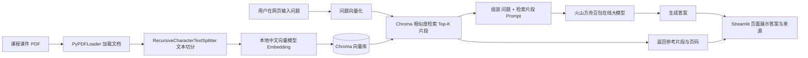
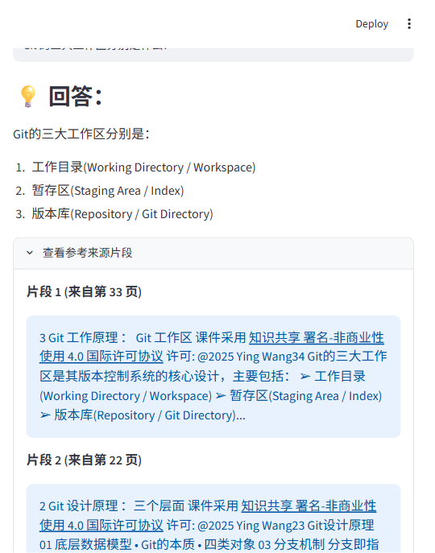

# 《开源软件构建技术》课程知识问答助手

> 基于 **LangChain** 框架 + **火山方舟豆包在线大模型** + **本地离线中文向量模型** 搭建的 **RAG（检索增强生成）智能应用**，以 Streamlit 作为网页交互界面，针对课程课件《开源软件构建技术 · 第 3 章 开源软件版本控制管理》进行问答，并给出答案对应的课件页码与原文片段。

## 一、作业要求与实现对照

| 作业要求 | 本项目实现 | 满足情况 |
| --- | --- | --- |
| 基于 **LangChain 框架**开发 | 使用 `langchain` 0.3.7 完成文档加载、文本切分、向量检索、检索增强问答链（`RetrievalQA`）全流程 | ✅ |
| 使用 **在线大模型**（或离线大模型） | 在线大模型：通过 OpenAI 兼容接口调用火山方舟 **豆包 `doubao-seed-2-0-mini-260428`**；语义向量模型为本地离线模型 `shibing624/text2vec-base-chinese` | ✅ |
| 开发一款**智能应用** | Streamlit 网页应用：自然语言提问 → 自动检索课件 → 大模型生成答案 → 展示参考来源片段与页码 | ✅ |
| 提供 **README 文档说明** | 即本文档 | ✅ |
| 附带**开源仓库链接** | GitHub 公开仓库，见文末「十四、仓库地址」一节 | ✅ |

## 二、功能特性

- **课件专属问答**：只基于上传的课程课件内容作答，避免大模型自由发挥、答非所问。
- **答案可溯源**：每条回答附带检索到的课件原文片段及其所在页码，便于核对。
- **本地离线向量化**：文本切分后使用本地中文向量模型生成语义向量，不依赖外部向量大模型服务。
- **网页式交互**：Streamlit 单页面应用，输入问题即可获取回答，操作门槛低。
- **配置与代码分离**：API Key、接口地址、模型名称统一放在 `.env` 中，更换模型或密钥无需改动业务代码。

## 三、技术栈

| 层次 | 技术 / 组件 | 版本 / 说明 |
| --- | --- | --- |
| 应用框架 | LangChain | `langchain==0.3.7`（文档加载、切分、检索、QA 链） |
| 在线大模型 | 火山方舟 · 豆包 `doubao-seed-2-0-mini-260428` | OpenAI 兼容接口 `https://ark.cn-beijing.volces.com/api/v3` |
| 本地向量模型 | `shibing624/text2vec-base-chinese` | Sentence-Transformers，本地离线运行 |
| 向量数据库 | Chroma | 进程内内存向量库，无需独立部署 |
| 文档解析 | PyPDFLoader（pypdf） | 读取课件 PDF |
| 网页界面 | Streamlit | 本地 Web 交互页面 |
| 语言 | Python | 3.12 |

## 四、RAG 工作流程与系统架构

应用采用典型的 **RAG（Retrieval-Augmented Generation，检索增强生成）** 流程：先把课件切分并向量化存入向量库；用户提问时，先检索最相关的课件片段，再连同问题一起交给大模型生成答案。



### 核心流程说明

1. **文档加载**：`PyPDFLoader` 读取 `data/` 目录下的课件 PDF。
2. **文本切分**：`RecursiveCharacterTextSplitter` 按 `chunk_size=500`、`chunk_overlap=100` 把长文档切成带重叠的文本片段，保证上下文连贯。
3. **本地向量化**：`HuggingFaceEmbeddings` 调用本地中文向量模型，为每个片段生成向量并写入 Chroma。
4. **语义检索**：用户问题向量化后，在 Chroma 中按相似度检索 `k=3` 个最相关片段。
5. **检索增强生成**：`RetrievalQA`（`chain_type="stuff"`）把检索到的片段与问题组装进 Prompt，交给在线大模型生成答案。
6. **来源回显**：`return_source_documents=True` 将检索到的原文片段与页码一并返回，在页面折叠面板中展示。

## 五、项目目录结构

```
rag-qa-assistant/
├── app.py                     # Streamlit 应用主程序（文档处理、检索、问答链、页面渲染）
├── requirements.txt           # Python 依赖清单
├── .env.example               # 环境变量配置模板（复制为 .env 后填写 Key）
├── .gitignore                 # Git 忽略规则（虚拟环境、缓存、密钥、课件 PDF 等不入库）
├── README.md                  # 项目说明文档（本文件）
├── data/
│   └── README.txt             # 课件 PDF 放置说明
├── docs/
│   └── app-screenshot.png     # 应用运行效果截图
├── model_cache/               # 本地向量模型缓存（已被 .gitignore 忽略，首次运行自动下载）
└── venv/                      # Python 虚拟环境（已被 .gitignore 忽略）
```

## 六、环境要求

- Windows / macOS / Linux 均可，开发环境为 **Windows + Python 3.12**
- 可访问火山方舟（`ark.cn-beijing.volces.com`）的网络环境
- 一个已开通 `doubao-seed-2-0-mini-260428`（或其他已开通豆包模型）的火山方舟 API Key

## 七、快速开始（Windows）

### 1. 克隆或下载本仓库

```powershell
git clone git@github.com:peach-Li-y/rag-qa-assistant.git
cd rag-qa-assistant
```

### 2. 创建并激活虚拟环境

```powershell
python -m venv venv
.\venv\Scripts\Activate.ps1
```

> 若 PowerShell 提示脚本执行策略受限，可先执行：
> `Set-ExecutionPolicy -Scope CurrentUser RemoteSigned`

### 3. 安装依赖

```powershell
pip install -r requirements.txt
```

### 4. 配置环境变量

复制模板文件并填入自己的火山方舟 API Key：

```powershell
copy .env.example .env
```

编辑 `.env`：

```env
OPENAI_BASE_URL="https://ark.cn-beijing.volces.com/api/v3"
OPENAI_MODEL="doubao-seed-2-0-mini-260428"
OPENAI_API_KEY="你的 API Key"
```

### 5. 放入课件 PDF

将课程课件 PDF 放入 `data/` 目录，并确保 `app.py` 中 `pdf_path` 的文件名与实际文件名一致：

```python
pdf_path = "data/《开源软件构建技术》第3章 开源软件版本控制管理-v1.5.pdf"
```

### 6. 启动应用

```powershell
streamlit run app.py
```

浏览器自动打开（或手动访问）：

```
http://localhost:8501
```

首次启动需要加载本地向量模型并构建课件向量库，请等待页面提示完成；之后再次启动会被 Streamlit 缓存，速度更快。

## 八、使用示例

在输入框中输入与 Git / 版本控制相关的问题，例如：

- `git概述`
- `Git 的三大工作区分别是什么？`
- `什么是暂存区？`
- `Clone、Fork、Commit、Push、Pull 分别是什么意思？`

页面将展示大模型基于课件生成的回答，并在「查看参考来源片段」折叠面板中列出命中的课件片段与页码。

### 运行效果



> 提问「Git 的三大工作区分别是什么？」后，模型基于课件给出答案，并标注命中的课件页码与原文片段。

## 九、代码结构说明（`app.py`）

| 函数 / 区块 | 职责 |
| --- | --- |
| 顶部环境配置 | 设置 HuggingFace 镜像地址；`HF_HUB_OFFLINE=1` 强制使用本地向量模型缓存，避免联网校验超时 |
| `load_and_process_document()` | 加载 PDF → 切分文本 → 本地向量模型 → 构建 Chroma 向量库，使用 `@st.cache_resource` 缓存 |
| `get_llm()` | 从 `.env` 读取接口地址、模型名、API Key，初始化 `ChatOpenAI` 在线大模型 |
| `main()` | 构建检索器与 `RetrievalQA` 问答链，渲染输入框、回答与来源片段 |

## 十、常见问题（FAQ）

**1. 报错 `InvalidSubscription / CodingPlan subscription`？**
接口地址必须使用标准通道 `https://ark.cn-beijing.volces.com/api/v3`，不要使用 Coding Plan 专属通道 `/api/coding/v3`；后者需要单独的 Coding Plan 订阅。

**2. 报错 `ModelNotOpen` 或 `InvalidEndpointOrModel.NotFound`？**
说明当前账号未开通该模型，或模型 ID 写错。请到火山方舟控制台「在线推理 → 模型开通」中开通对应模型，并把 `.env` 中的 `OPENAI_MODEL` 改成控制台显示的完整模型 ID（连字符 + 日期后缀）。

**3. 启动时卡在 HuggingFace 模型下载 / 超时重试？**
本地已有模型缓存时，`app.py` 顶部 `HF_HUB_OFFLINE=1` 会强制离线加载；若换到全新机器、本地无缓存，把该行临时改为 `os.environ['HF_HUB_OFFLINE'] = '0'`，待模型下载完成后再改回 `'1'`。

**4. 提示「找不到文件」？**
检查 `data/` 目录下 PDF 文件名是否与 `app.py` 中 `pdf_path` 完全一致（含书名号、空格、版本号）。

**5. 8501 端口被占用？**
指定其他端口启动：`streamlit run app.py --server.port 8502`。

## 十一、可扩展方向

- 接入多份课件 / 多目录 PDF，构建整门课程的知识库；
- 增加对话历史记忆，支持多轮追问；
- 切换为本地离线大模型（如 Ollama 部署 Qwen），实现完全离线运行；
- 增加向量库持久化存储，避免每次启动重新构建；
- 增加提问历史记录与答案评分反馈。

## 十二、参考资料

- LangChain 官方文档：<https://python.langchain.com/>
- Streamlit 官方文档：<https://docs.streamlit.io/>
- 火山方舟大模型服务平台：<https://www.volcengine.com/product/ark>
- 向量模型：`shibing624/text2vec-base-chinese`（Hugging Face / ModelScope）

## 十三、开源协议

本项目仅用于课程作业学习交流，课件 PDF 版权归原作者所有。代码部分可按 MIT 协议自由学习与参考。

## 十四、仓库地址

- GitHub（公开仓库）：<https://github.com/peach-Li-y/rag-qa-assistant>
- SSH 克隆地址：`git@github.com:peach-Li-y/rag-qa-assistant.git`
- HTTPS 克隆地址：`https://github.com/peach-Li-y/rag-qa-assistant.git`
